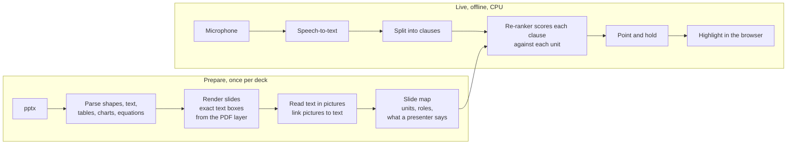

# Smart Pointer

While a presenter talks, Smart Pointer highlights the part of the slide they are talking about. It listens through the microphone, works out which box, card, chart bar or table cell the sentence is about, and moves the highlight there. During the talk it runs offline on a CPU.

**The source code is private (not yet released). This repository only describes the work.**

Personal project, May to November 2026. Python, speech-to-text, small transformer models, a local web app.

## What it does

1. Drop a `.pptx` into a local web app. Each deck is prepared once: parsed, rendered, and given a "slide map" that says which parts of each slide can be pointed at.
2. Present full screen in the browser. Speech-to-text runs on the CPU, a small re-ranker decides which part of the slide each sentence refers to, and the highlight follows.
3. Change slides with the keyboard, a clicker, or by voice ("next slide", "go back", "slide five"). If the presenter moves on without saying so, auto-follow turns the slide. Live subtitles show what the recogniser hears.

## How it works

### Prepare

- **Parser.** The slide library does not see everything on a slide. It skips text boxes and tables that hold equations, and a slide with pen ink fails to parse. So the parser also walks the raw slide XML. It reads equations and table math, and drops hidden shapes, shapes covered by others and shapes parked off the slide. Each text element gets its exact box from the rendered PDF's text layer, not a guess from font sizes.
- **Pictures.** Text baked into pictures is read with OCR, filtered so it does not invent text on icons. A CLIP model links a picture with no text to the label it illustrates.
- **Slide map.** For each slide, a model looks at the rendered image and the element list. It groups elements into the units a presenter would point at, such as a card or a picture with its caption. For each unit it writes short phrases a presenter might say about it. The Claude API writes the maps by default. A local model (Qwen 3.5 4B through Ollama) is the fallback when there is no network.

### Live

- **Speech-to-text** runs on the CPU. Canary 180M Flash is the default, cut into phrases at short pauses. Two streaming models are fallbacks.
- **Clause pointer.** It decides once per clause, not on every word update. A cross-encoder (TinyBERT, 2 layers) reads the clause together with each unit's description and scores it. A fixed "none" bar stops it from lighting anything when the presenter is not talking about the slide. The pointer then holds its choice until a new clause clearly points elsewhere.
- **Deterministic.** Single-thread CPU, pinned model versions, no network. The same audio always gives the same highlights, so every change can be compared exactly on recorded talks.

## How it was evaluated

- **Bench.** Each deck has talk scripts in three styles: reading the slide in order, jumping around, and referring to things by meaning ("that quote"). Every sentence is labelled with the element it is about. A TTS voice speaks the scripts, and the audio goes through speech-to-text and the pointer on an audio clock, faster than real time. The scores are steps lit, wrong highlights, flicker and how late each highlight comes.
- **Held-out decks.** Seven public talks were downloaded and frozen before testing: from NASA, the CDC, the US Federal Highway Administration, KU Leuven, ZBW, CESSDA and King's College London. Nobody opened their slides during development. They were scored with the shipped settings, without tuning.
- **Tune on some talks, check on others.** Settings are chosen on tuning talks and then checked on talks that were held back. Three changes that looked good on the tuning talks failed the held-out talks, so they were shipped switched off.

## Results

| What was measured | Result |
|---|---|
| 7 unseen decks, 21 talks, 2,078 pointing steps, with slide maps | **77.3%** of steps lit, 2.4 wrong highlights per talk |
| The same decks without slide maps | 72.5% lit, 320 wrong highlights in total (51 with maps) |
| By talk style: in order / jumping / by meaning | 82.1% / 79.8% / 70.4% |
| Decks used during development | 82% to 97% lit |
| Re-ranker cost per decision | 16 ms on one CPU thread |
| Auto-follow over 33 continuous synthetic talks | 647 of 741 slide changes caught, 2 early jumps |
| The project's own 7-slide test deck, hand-written script | 38 of 40 steps lit, 1 wrong highlight |

Speech-to-text was chosen on a real voice: one recording of the author reading a known paragraph.

| Model | Word error rate |
|---|---|
| Canary 180M Flash | **11.3%** |
| Parakeet TDT 0.6B v3 | 18.9% |
| Nemotron 0.6B streaming | 24.5% |
| Whisper large-v3-turbo | 32.1% |
| Streaming zipformer (the first engine) | 49.1% |

## What the measurements changed

- **Slide maps are the biggest lever.** On the unseen decks they added 100 lit steps and cut wrong highlights from 320 to 51.
- **Small models won on the full pointer.** The 2-layer TinyBERT re-ranker beat larger re-rankers, a local 1.5B LLM and a 421M choice model once the whole pointer was scored. On a held-out talk it lit 57 of 59 steps against 48 and 46, at 16 ms per call against 136 ms and 467 ms.
- **Better transcripts did not always mean better pointing.** One engine cut the word error rate by 37% on the synthetic talks and lit no more steps. Its earlier words led to more decisions on half-finished sentences.
- **A better OCR model did not pay.** PP-OCRv6 read 95% of the words on rendered slides against 75% for tesseract. Rebuilding nine decks with it changed lit steps by 0.2%, so tesseract stayed.
- **Every recall gain needs a negative test.** Talk that names nothing ("as you can see here, this is important") used to light labels. A per-element "null" score, built from generic presenter phrases, took those false highlights on held-out filler from 36 to 5.
- **Most of the delay is the speaker.** The first speech-to-text engine lagged about 0.5 s. Most of the roughly 2.4 s median delay comes from presenters naming the thing a second or two into the sentence.

## Limitations

- Every pointer score above uses a synthetic voice reading scripts written by AI agents (or by hand, for the test deck), and the agents also labelled the answers. Only the choice of speech-to-text used a real voice, one speaker. It has not yet been measured on a real presentation.
- The delay from a spoken word to the highlight has not been measured on the live path.
- The unseen-deck scores used maps written by Claude agents. The map writer built into the app scores a little lower on the deck compared (160 against 162 lit steps), and the local model lower again (148). Writing maps with Claude needs the network once, when the deck is prepared.
- Slide titles and section slides are 30% of the misses, pictures with no usable text 15%, and "the second row" style references most of the rest.
- Some slide content is not parsed yet: SmartArt, merged table cells, stacked, horizontal and line chart geometry, rotated or flipped groups. Animations are not modelled. It presents a static render of each slide.
- English only.

## Tech stack

- **Slides:** python-pptx and raw XML, LibreOffice, pypdfium2, tesseract, CLIP
- **Models:** sherpa-onnx (Canary 180M Flash, Nemotron 0.6B, zipformer), Hugging Face Transformers on PyTorch (TinyBERT-L2 cross-encoder, bge-small embeddings), Claude API and Ollama (Qwen 3.5) for slide maps
- **App:** FastAPI, WebSockets, plain JavaScript, PulseAudio microphone input
- **Bench:** Piper and Kokoro TTS, pytest (554 tests passing at the last count), ruff

About 18,000 lines of Python in the app and tools, and 8,000 lines of tests.
